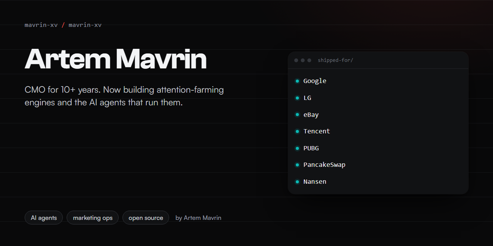

# Artem Mavrin

CMO for 10+ years. Shipped marketing for Google, LG, eBay, Tencent, PUBG, PancakeSwap and Nansen.

Now I build attention-farming engines: a network of media accounts and the AI agents that run it. SEO, ads, tracking, content and sales are done by agents. A human approves anything that costs money or goes public.

## Open source

Nineteen skill packs taken from the systems I run. Full index: **[agent-skill-packs](https://github.com/mavrin-xv/agent-skill-packs)**.

| Pack | Job |
|---|---|
| [seo-operator](https://github.com/mavrin-xv/seo-operator) | SEO as a weekly loop: measure, pick one change, ship it, verify 21 days later |
| [anti-slop-kit](https://github.com/mavrin-xv/anti-slop-kit) | A grep gate and a critic loop that strip AI tells from a draft |
| [google-ads-doctor](https://github.com/mavrin-xv/google-ads-doctor) | Finds where Google Ads spend leaks and fixes it in order |
| [offer-lab](https://github.com/mavrin-xv/offer-lab) | From a skill to a priced, tested offer with evidence caps on every score |
| [decision-council](https://github.com/mavrin-xv/decision-council) | Five advisors, blind peer review, one verdict, a pre-mortem |
| [butler](https://github.com/mavrin-xv/butler) | A family assistant in a Telegram group on SQLite and markdown |

## How the packs are built

- Scripts do the arithmetic. The model never scores its own work.
- Gates exit non-zero. A failed check stops the run.
- Every pack ships a worked example and a list of what it will not do.
- No keys in the repo. Secrets come from your environment.

## Stack

Claude Code, Codex, Python standard library, Cloudflare Workers and D1, Telegram Bot API, PostHog, GA4, Search Console.
